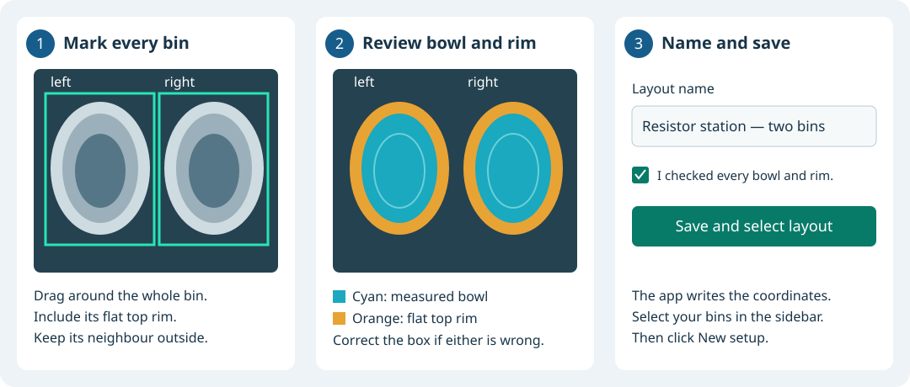
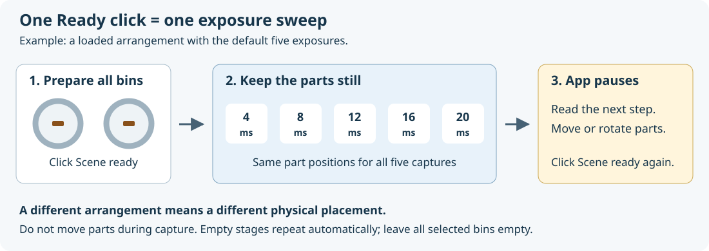
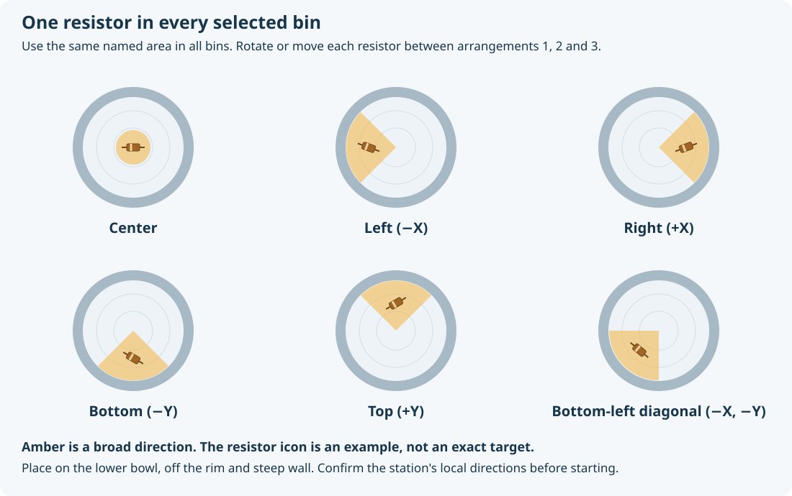

# Bin Setup: operator guide

Use this guide to collect empty-bin and part captures, build a model, check it,
and put a passing model into service. Bin Setup runs in a browser on the station
PC. Collection needs the camera and Eyes services. The app never moves the robot.

**First time on this station?** Have the integrator complete
[station installation](STATION_SETUP.md#station-installation) and confirm the
scene, bin names and diagram directions. After that, follow the steps below.

## 1. Open Bin Setup

1. Stop production and park the arm clear of the camera view using the normal
   station procedure. Leave the camera and Eyes services running.
2. Open a terminal at the workspace root and run:

   ```bash
   bin_filter_offline/.venv/bin/python bin_filter_offline/bin_setup.py
   ```

3. Leave that terminal open. In a browser on the same PC, open
   **http://localhost:8765**. The page also has a **Step-by-step guide** link
   for keeping these instructions beside the app.
4. If you are continuing a collection, select its name and click **Open session**.
   Continue with its first unfinished instruction; do not create another session.

A browser refresh does not stop collection. The terminal runs the application.
If the page is already open from an earlier server, refresh it after restarting
the server to load the current UI.

## 2. Select the scene and bins

For a new collection:

1. Select the **Scene**, its camera calibration and reference frame. Choose an
   existing **Bin layout**, or create one from a picture using the steps below.
   Scene 0 is not a universal default for every station.
2. Check every bin you want to collect. One capture records all selected bins
   together; you do not need a separate collection for each bin.
3. Give the session a readable name, such as `fremont-resistors-oct25`.
   If you leave the name blank, the app supplies a readable name.
4. Leave exposures at **4, 8, 12, 16, 20 ms**, unless this station's recipe calls
   for other values. Each value applies to both spotlight and structured light
   on both cameras.
5. Click **New setup**.

The sidebar selections prepare a **new** session. An opened session keeps its
saved scene, bins and exposure plan. If a required camera calibration or reference
frame is missing, ask the integrator to configure it; changing the scene number
does not calibrate the station.

### First layout, or bins moved? Mark them on a picture

You do **not** need to know coordinates, bin height or rim height. The app derives
these from the calibrated empty-bin depth capture.

1. Select the station's **Scene**, **Camera calibration** and **Reference frame**.
2. Click **Create bin layout**. Empty every bin and leave it mounted in its usual
   position. Keep the arm outside the camera view.
3. Tick **Every bin is empty, mounted in its usual position, and clear of the
   arm**. Click **Check selected scene**, and wait for **Cameras ready**.
4. Click **Capture empty scene**. This makes a separate layout preview; it does
   not begin or change your training collection.
5. On the picture, drag a box **just outside the complete outer edge** of the
   first bin. Include the **entire flat top rim on all four sides**, leaving
   neighbouring bins outside. You do not need to trace the exact curved bowl edge.
6. Replace `bin_1` with a useful name, such as `left` or `resistors`. Start with a letter,
   then use letters, numbers, underscores or hyphens (up to 64 characters).
   Names must be different for every bin.
7. Click **Add another bin** and draw its box. Repeat for every bin you want in
   this layout. **Draw again** replaces a box; **Remove** deletes it.
8. Click **Find bowl and top rim**. In the review picture, check that cyan follows
   the measured bowl interior and orange follows its flat upper rim. Check the
   names and displayed dimensions for every bin. Compare with the original
   picture: a box can pass the checks while cutting off some of the rim. If it
   includes a neighbour or misses any outer rim, redraw and run this step again.
9. Enter a readable **Layout name**, such as `Resistor station — two bins`. Tick
   **I checked every bin’s bowl and top rim**, then click **Save and select layout**.
10. Return to the sidebar. Your new layout is selected. Check the bins, name your
    collection, and click **New setup**.



The picture is a top-down depth view: +X points right and +Y points up in the
selected reference frame. It can look rotated compared with the camera image or
your position at the station. Saved layouts live under `data/bin_model/layouts/`;
the app writes the fitting settings for you. Existing sessions keep their own
saved layout. Create a new session to collect with a changed layout.

If the app cannot find a usable bowl and rim, check that the bins are empty and
fully visible, then correct the boxes or take a new empty view. A failed layout
review is not saved as a usable layout. The full training and validation steps
still run after layout creation.

## 3. Check the cameras and take a preview

1. Click **Check connection**. Wait for **Cameras ready**.
2. Remove all parts from all selected bins. Leave the bins in their normal
   mounted positions.
3. Click **Preview cameras**.
4. Check that the expected bins appear in the preview and the arm is out of view.
   If the bins or orientation look wrong, resolve that before collecting.

Preview images are separate from the training and validation captures. When
connection readiness fails, expand **Connection details**, fix the listed
problem, and click **Check connection** again. Collection buttons remain disabled
until the connection is ready.

## 4. Capture the empty bins

1. Read the main stage instruction. Confirm **every selected bin is completely
   empty**.
2. Click **Scene ready — capture exposures** once.
3. Keep the bins unchanged while the app captures the empty training stage.
4. When the app asks for fresh empty validation, check the bins are still empty
   and click **Scene ready — capture exposures** again.

With the default recipe, empty training has **35 captures** and fresh empty
validation has **15 captures**. The repeated empty captures run automatically.
The app pauses before asking you to put parts in the bins.

## 5. Capture one resistor in every bin



For each loaded stage:

1. Read the **location** and **arrangement number** in the current instruction.
2. Put **exactly one resistor in each selected bin**, in that named area.
   For example, a left-side stage means one resistor toward the left side of
   every selected bin.
3. Click **Scene ready — capture exposures** once.
4. Leave the resistors still until the entire sweep finishes: **4 → 8 → 12 →
   16 → 20 ms** with the default settings.
5. When the next arrangement appears, rotate or move **each bin's resistor**
   within the requested area. Click Ready again only after all bins are prepared.

**Do not move parts between exposures in one sweep. Do move or rotate them
between arrangements.** An arrangement showing `0/5` requires one Ready click.
`5/5` means that arrangement's sweep is complete.



The default guide visits **center, left, right, bottom, top and bottom-left
diagonal**, with three arrangements at each location. The amber area gives a
broad direction; the resistor drawing is an example, not an exact spot. On a
curved bowl, place the resistor naturally on the lower bowl, off the flat rim
and steep wall. There is no required distance from the wall and no physical
corner to find.

**Use the directions shown for this station.** Left/right/top/bottom refer to
bin-local −X/+X/+Y/−Y. They can differ from the camera image or your view while
standing at the machine. Have the integrator identify these directions once;
keep that convention throughout collection.

## 6. Capture normal and full bins

1. At **normal fill**, put a typical working amount of production parts in all
   selected bins. Spread them naturally, leaving some bin surface visible.
2. Click Ready and keep the parts still for the sweep.
3. Between the three normal-fill arrangements, mix or reposition the parts,
   keeping roughly the same amount.
4. At **full fill**, use a representative full production load within the
   station's normal fill limit. Repeat three arrangements, changing the parts'
   positions and overlaps between sweeps.

No exact normal/full part count is required. Follow the current stage instruction
for every bin. With five exposures, the complete default collection has:

| Stage | What you prepare | Captures | Ready clicks |
| --- | --- | ---: | ---: |
| Empty training | All bins empty | 35 | 1 |
| Empty validation | All bins still empty | 15 | 1 |
| One resistor | Six areas × three arrangements, in all bins | 90 | 18 |
| Normal fill | Three different arrangements, in all bins | 15 | 3 |
| Full fill | Three different arrangements, in all bins | 15 | 3 |
| **Total** | **Any number of selected bins** | **170** | **26** |

Counts change if the station uses a different recipe or exposure list. Older
saved sessions retain their original instructions and counts; follow the opened
session rather than assuming this table applies to it.

## 7. Add CAD if you have it

CAD is optional. To build from real captures alone, leave **Geometry reference
for this build** at **Measured captures only** and go to step 8.

For a completed collection with a CAD reference:

1. Choose the bin's **STL** file. Use the part's actual nominal design,
   including its flat top rim.
2. Choose whether that design applies to all selected bins or one bin, then
   click **Upload CAD**. Different bin shapes need their own files.
3. For each bin, select the file's **units**, the axis that points **up**, and its
   **yaw**. STL does not record units. Ask the CAD author or integrator if these
   are unknown; a millimetre/inch mix-up cannot be fixed by fitting.
4. Click **Preview CAD placement**. The app places the reference using saved
   **empty training** geometry, keeping scale fixed.
5. Review the top view and both cross-sections: **blue is measured geometry;
   orange is CAD**. Confirm that the bowl opens upward, size is correct, and the
   rim and interior line up. If the wrong side faces up or the shape is wrong,
   correct the choices and preview again.
6. After checking every selected bin, tick **I checked the bin size and
   orientation in every preview**, then click **Confirm CAD reference**.
7. Select the confirmed reference under **Geometry reference for this build**
   before clicking **Build and validate**.

Previously commissioned references matching this session can also appear in
that selector. CAD selection applies to the open session, not the sidebar's
settings for a future session.

The measurements still supply the physical surface and top-rim registration
points, including printing or machining differences. CAD guides which measured
surface belongs to the bin; it does not fill unseen areas or raise the part
removal threshold. A CAD-assisted candidate must pass the same held-out checks.

## 8. Build and read the result

1. Once every stage is complete, click **Build and validate**.
2. Leave the server terminal running. Follow **Activity** for progress. Building
   and replaying the whole dataset is an offline operation; it is separate from
   the time required for one production pose request.
3. Wait for the final result. You can use **Review saved results** to reopen it.
4. If checks fail, review the named capture, bin and exposure. Correct the
   identified problem before deployment. A finished build is not automatically
   a passed validation.
5. When physical production validation passes, **Use this model** becomes
   available. Building alone does not change the model used by production.

The fit uses empty training captures. Fresh empty, resistor and filled captures
are held out for validation. A resistor check verifies a target in the instructed
broad area; it does not establish the exact resistor footprint or grasp accuracy.
Each build creates a new candidate, preserving earlier candidates and captures.

## 9. Activate and run the HMI contour test

This example is for **cell 4, scene 0/B2, bin_a and bin_b**. Another scene or bin
layout needs its matching commissioned HMI workflow.

1. Finish collection. Start the station's normal camera, Eyes, updated Perception,
   Brain and HMI services using the normal station procedure.
2. In HMI, select **Celestica Contour Map Test**, click **Launch**, and wait for
   the nodes to become ready. Leave it ready to **Run**; do not start a pose
   request during activation.
3. In Bin Setup, click **Use this model**. Wait for successful activation. The
   app updates the model path and verifies which model Perception loaded.
4. Put parts in both bins, then click **Run** in HMI. This test requests a pose
   from bin_a and then bin_b; it does not move the robot.

An empty bin returns no pose, so both bins need parts for this two-bin test to
succeed. If activation reports a missing reload service, ask the integrator to
start the updated Perception build and load the matching workflow. Do not treat
that error as successful activation. See the
[detailed HMI setup](STATION_SETUP.md#activate-and-run-the-hmi-contour-test) for
configuration paths, camera settings, RViz and restarting cached settings.

**Restore previous model** restores the recorded previous deployment when one
is available. Activation failures restore the earlier pipeline configuration.

## Where your files go

| Files | Default host location |
| --- | --- |
| Captures, logs, previews, CAD uploads and all build/validation results | `data/bin_model/<session-name>/` |
| Full candidate, including training settings and CAD evidence | `data/bin_model/<session-name>/candidate-NN/` |
| Model used by production: `model.json` and numerical `arrays/` | `ebots_system_artifacts/artifacts_cell_4/calibration/deployment/bin/<model-name>/` |
| Shared station calibration | `ebots_system_artifacts/artifacts_cell_4/calibration/deployment/camera/` and `robot/` |
| Deployment state and rollback history | `data/bin_model/deployment/` |

The first candidate directory may be named `candidate`; later builds use names
such as `candidate-02`. Only the runtime files go into artifacts. Captures,
training settings, CAD meshes and validation reports stay with the local session.
Production uses the existing shared camera and robot calibration. The model
records expected calibration values so a changed calibration can be detected.
Frozen calibration files remain with offline captures and candidates for replay.
The runtime does not load an STL or fit CAD on each pose request.

## If something goes wrong

| What you see | What to do |
| --- | --- |
| **Address already in use** at startup | Open the existing page first. If another application owns that port, run with `--port 8766` and open `http://localhost:8766`. Stop an old Bin Setup server before starting another on the same data root. |
| **Camera connection needs attention** | Expand Connection details, resolve the listed camera/Eyes issue, then Check connection again. Do not start a duplicate Eyes service for the same scene. |
| A capture fails | Keep the session. Fix the reported problem, prepare that unfinished arrangement again, and click Ready. The app preserves the failed attempt and retakes that arrangement's entire sweep. |
| You need a pause | Click **Stop after current capture**. Wait for the current request to finish. Later, Open session resumes at the first unfinished stage. |
| The app waits for camera buffers after a timeout | Leave the server running while cleanup finishes. See the [recovery instructions](STATION_SETUP.md#stopping-recovery-and-daily-checks) if Eyes cannot finish. |
| The browser closes | Reopen the page. The server finishes its current stage and waits before the next arrangement. |
| A completed arrangement was prepared incorrectly | Record its stage name and ask the integrator to reset that stage's data before building; do not relabel the saved capture as a different placement. |

For a daily empty-bin check, choose **New empty check**, capture the fresh empty
stages, then click **Validate empty check**. It checks the active model without
refitting. It does not replace full validation for changed lighting, calibration,
parts or acquisition settings.

When finished, use **Ctrl+C** in the server terminal. It requests a stop between
captures and waits for an active operation to finish. Do not close that terminal
while a capture is cleaning up.
